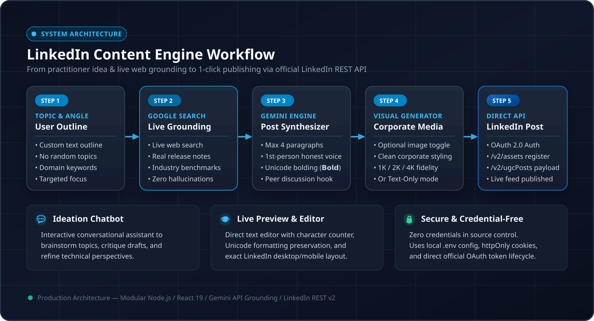

# GenAI LinkedIn Poster

An automated, practitioner-grade LinkedIn content creation and publishing engine powered by **Google Gemini** and **LinkedIn OAuth 2.0 APIs**.

Unlike generic AI writing tools that produce long-winded, hyperbolic, or "hype-heavy" content, this platform enforces a concise, grounded, practitioner-to-practitioner format with real-time web search grounding and optional corporate-grade visuals.

---

## Why This Exists (Problem & Solution)

### The Problem
* **AI Slop & Generic Hype:** Most automated AI posts sound like marketing fluff—overly long, full of buzzwords, and lacking technical substance.
* **Stale Hallucinations:** Large language models without web search often hallucinate dates, benchmarks, or reference outdated frameworks.
* **Glowy, Cluttered AI Graphics:** Standard AI image generation defaults to neon, dark cyberpunk aesthetics that look unrefined and unprofessional on LinkedIn.
* **Manual Copy-Paste Overhead:** Drafting in one app, designing graphics in another, and manually uploading to LinkedIn creates friction.

### The Solution
* **Practitioner Blueprint:** Restricts posts to **under 4 short paragraphs (100–120 words)**. Direct first-person voice, actionable architectural/technical insights, and a peer-level discussion prompt.
* **Live Web Grounding:** Uses Google Search grounding to fetch the latest research breakthroughs, release notes, and industry benchmarks before drafting.
* **Clean Corporate Visuals:** Generates minimalist, corporate-toned graphics (formal color palettes, clean negative space, 1K/2K/4K resolution) or allows publishing pure text without images.
* **1-Click Direct Publishing:** Integrates directly with LinkedIn REST API v2 (`/v2/ugcPosts` and `/v2/assets`) via OAuth 2.0.

---

## System Architecture & Workflow

<p align="center">
  
</p>

The system operates across five sequential stages:
1. **User Topic & Outline:** Ingests your targeted topic, notes, and research sources directly from the UI without random selection.
2. **Gemini Live Search Grounding:** Queries Google Search in real-time to retrieve up-to-date documentation, technical release notes, and industry benchmarks.
3. **Practitioner Synthesis:** Crafts an authentic, concise post under 4 paragraphs (100–120 words) with Unicode bolding (`𝗕𝗼𝗹𝗱`) for clean LinkedIn feed rendering.
4. **Corporate Visual Engine:** Optionally generates high-resolution, formal graphics (1K, 2K, 4K) or allows publishing purely text-only posts.
5. **Direct LinkedIn API:** Connects via OAuth 2.0 to register image binary assets (`/v2/assets`) and publish UGC feed posts (`/v2/ugcPosts`).

---

## Key Features

1. **Grounded Post Generation**
   - Provide any topic or rough outline in the UI.
   - Gemini queries the live web via Google Search to pull accurate, up-to-date technical details.
   - Generates posts structured as:
     1. **Opening:** Direct, first-person evaluation or experience.
     2. **Insight:** Specific technical, architectural, or strategic insight.
     3. **Implication:** Real-world impact on workflows or systems.
     4. **Question:** Peer-level question to foster professional discussion.
   - Clean Unicode Sans-Serif bolding (`𝗕𝗼𝗹𝗱`) instead of markdown asterisks that break in LinkedIn feeds.

2. **Choice of Media (Image + Text or Text-Only)**
   - Toggle to include or exclude images on a per-post basis.
   - Multi-resolution corporate image generation (1K, 2K, 4K) adhering to clean, minimalist aesthetics.

3. **Built-in Ideation Chatbot**
   - Interactive conversational assistant powered by Gemini to brainstorm topics, critique drafts, or adapt tone.

4. **Seamless LinkedIn Integration**
   - Secure OAuth 2.0 authentication (`openid`, `profile`, `email`, `w_member_social`).
   - Multi-step media asset registration and binary chunk upload for feed images.
   - Real-time post status feedback.

---

## Tech Stack

| Layer | Technology |
|---|---|
| **Frontend** | React 19, TypeScript, Vite, Tailwind CSS v4, Motion, Lucide React |
| **Backend** | Node.js, Express, Cookie-Parser, Axios |
| **AI Models** | `@google/genai` (Gemini with Google Search Grounding & Image Generation) |
| **Integrations** | LinkedIn REST API v2 (UGC Posts, Asset Media Upload, OAuth 2.0) |

---

## Directory Structure

```text
├── docs/
│   ├── architecture.png      # High-resolution system architecture & workflow diagram
│   └── architecture.svg      # Scalable vector diagram source
├── server.ts                 # Express server with LinkedIn OAuth, UGC posting & Vite dev middleware
├── index.html                # Main HTML entry point
├── package.json              # Dependencies & scripts
├── tsconfig.json             # TypeScript configuration
├── vite.config.ts            # Vite configuration with Tailwind CSS v4
├── .env.example              # Environment variable template
├── src/
│   ├── main.tsx              # React application root
│   ├── App.tsx               # Main application shell with navigation tabs & auth state
│   ├── index.css             # Global Tailwind styles
│   └── components/
│       ├── PostGenerator.tsx # Topic input, prompt synthesis, image generator & publishing
│       ├── Chatbot.tsx       # Interactive AI brainstorming assistant
│       └── ConfigPanel.tsx   # Domain keyword & research source configuration
└── README.md                 # Project documentation
```

---

## Getting Started

### 1. Prerequisites
* **Node.js** v20.x or higher
* **npm** or **bun**
* **Google Gemini API Key** (from [Google AI Studio](https://aistudio.google.com/))
* **LinkedIn Developer App** (from [LinkedIn Developer Portal](https://www.linkedin.com/developers/))

### 2. Configure LinkedIn Developer App
1. Create an application on the [LinkedIn Developer Portal](https://www.linkedin.com/developers/).
2. Under the **Products** tab, request access to:
   * **Share on LinkedIn**
   * **Sign In with LinkedIn using OpenID Connect**
3. Under the **Auth** tab:
   * Copy your **Client ID** and **Client Secret**.
   * Add your redirect URI to **Authorized redirect URLs for your app**:
     ```text
     http://localhost:3000/auth/callback
     ```
     *(If deploying to Cloud Run or a custom domain, add `https://your-domain.com/auth/callback`)*.

### 3. Clone & Install Dependencies

```bash
git clone https://github.com/your-username/genai-linkedin-poster.git
cd genai-linkedin-poster
npm install
```

### 4. Setup Environment Variables
Create a `.env` file in the project root:

```env
# Gemini API Key
GEMINI_API_KEY="your-gemini-api-key"

# App URL (used for OAuth redirect callbacks)
APP_URL="http://localhost:3000"

# LinkedIn OAuth App Credentials
LINKEDIN_CLIENT_ID="your-linkedin-client-id"
LINKEDIN_CLIENT_SECRET="your-linkedin-client-secret"
```

### 5. Run the Application

#### Development Mode:
```bash
npm run dev
```
Open [http://localhost:3000](http://localhost:3000) in your browser.

#### Production Build:
```bash
npm run build
npm run start
```

---

## How to Push to Your GitHub Repository

If you are updating your existing GitHub repository with these changes, run the following commands from your local project root:

```bash
# 1. Initialize git if not already initialized
git init

# 2. Add your GitHub remote repository (replace with your repo URL)
git remote add origin https://github.com/<your-username>/<your-repo-name>.git

# 3. Stage all modified and added files
git add .

# 4. Commit your changes
git commit -m "feat: grounded post generator, clean visuals, LinkedIn integration, and docs"

# 5. Push to your main branch
git branch -M main
git push -u origin main
```

---

## License

MIT License. Open source and free to use for personal or commercial workflows.
